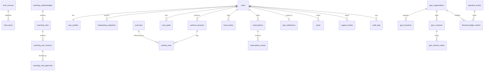

# Entity relationship diagram

The migration is the source of the columns. This diagram is the relationship map. It has not been applied to a server.

`financial_ledger_entries` and `audit_logs` reject updates and deletes with a trigger. `commission_ledger` is a view of gym commission lines and rejects writes.
